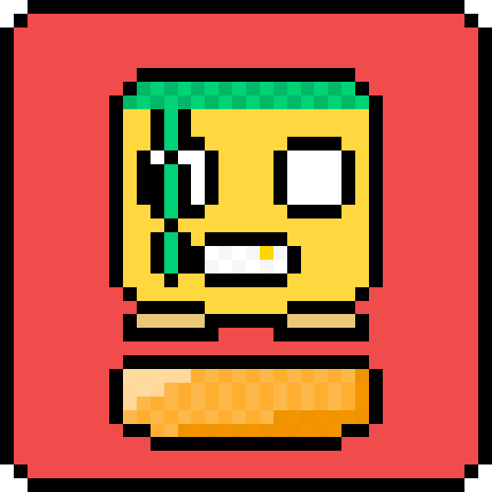

# Rage Jump

<p align="center">
  
</p>

<p align="center">
  <strong>An endless 2D vertical platformer built with Unity and C#</strong>
</p>

<p align="center">
  
  
  
  
  
  
</p>

---

## About the Project

> [!NOTE]
> ### Handcrafted in 2018 — Before the AI Era
> 
> This game was developed in **2017–2018** by **Nicola Forasacco**. Every single line of code, pixel art sprite, animation curve, physics setting, procedural generation algorithm, and sound effect was **completely crafted by hand**, well before the advent of generative AI, code assistants, or automated workflows. It represents authentic manual indie development from the late 2010s.
>
> The project was recently updated to **Unity 2020.3 LTS**, with legacy third-party ad networks and proprietary mobile SDKs removed, making it clean, self-contained, and publicly accessible to anyone interested in exploring the codebase.

---

## Gameplay Overview

**Rage Jump** is a fast-paced vertical platformer where the objective is straightforward: climb as high as possible while dodging deadly obstacles and staying ahead of the rising camera.

As height increases:
- Camera scroll speed continuously accelerates, punishing hesitation.
- Platforms become sparser and introduce trickier movement patterns.
- Obstacles and hazards spawn dynamically to challenge player reflexes.
- Players collect **Donuts** scattered throughout the run to unlock characters in the shop.

### Key Features

- **Arcade Vertical Action:** Responsive controls built around tight 2D physics.
- **70 Handcrafted Pixel Art Characters:** Unique sprites unlockable using collected in-game Donuts.
- **Dynamic Platform Types:** Multiple platform variants with distinct physical properties and interactions (bouncers, moving platforms, fragile tiles, scoring surfaces).
- **Enemies and Hazards:** Falling pencils that can be stomped for extra points or cause instant death from below, alongside flying shurikens across the screen.
- **Comic Quips:** Random humorous speech bubble messages displayed above the player character at the start of each attempt.
- **Visual Polish and Game Feel:** Screen shake effects, slow-motion death sequences, procedural background color shifts, and multi-layered parallax scenery (clouds, hot-air balloons, butterflies, and birds).
- **Persistent Statistics:** Comprehensive tracker recording total jumps, best heights, donuts collected, and death causes (pencils, shurikens, spikes).

---

## Platform and Tile Mechanics

| Tile Type | Behavior |
| :--- | :--- |
| **Normal Tile** | Standard static platform for landing and jumping. |
| **Moving Tile** | Moves horizontally back and forth with configurable speeds. |
| **Cloud Tile** | Atmospheric floating cloud platform. |
| **Useless / Fragile Tile** | Crumbles upon landing. Must be used quickly; awards bonus points. |
| **Alternating Tile** | Periodically disappears and reappears on a timer. |
| **Colorize Tile** | Splashes color across the platform on impact, awarding a large score bonus. |
| **Bounce Tile** | Supercharged spring platform launching the player upward with increased force. |
| **Spine / Spike Tile** | Covered in spikes; causes immediate death on contact. |

---

## Controls

### PC / Standalone / Unity Editor
| Action | Input |
| :--- | :--- |
| **Move Left** | `A` or `Left Arrow` |
| **Move Right** | `D` or `Right Arrow` |
| **Jump** | `Spacebar` |
| **Menu Confirm / Select** | `Enter` / `Submit` |

### Mobile / Touch
- **On-Screen Buttons:** Dedicated touch triggers for directional left/right movement and jumping.

---

## Project Structure

```
Assets/
|-- Audio/            # Sound FX (jumps, pickups, explosions) and background music tracks
|-- Font/             # Custom pixel art fonts and materials
|-- Prefab/
|   |-- Characters/   # ScriptableObject character definitions (Ch1 - Ch70)
|   `-- Tiles/        # Platform prefabs and obstacle objects
|-- Scene/
|   `-- MainScene     # Main gameplay and UI scene
|-- Scripts/          # C# gameplay codebase
|   |-- GameManager.cs            # Game flow, scoring, UI triggers
|   |-- PlayerMovement.cs         # Character physics, impulses, collisions
|   |-- SpawnTileManager.cs       # Procedural platform and hazard generation
|   |-- sliderCharacterManager.cs # Character shop and selector carousel
|   |-- CameraController.cs       # Follow camera, speed ramp, background color shifts
|   |-- CameraShake.cs            # Screen shake and slow-motion handling
|   |-- AudioManager.cs           # Audio channels and track management
|   |-- PreferenceManager.cs      # Persistent PlayerPrefs storage
|   `-- TileBehavior.cs           # Individual tile logic and animations
`-- Sprites/          # Hand-drawn pixel art sprites, UI icons, and animations
```

---

## Getting Started

### Prerequisites
- **Unity 2020.3 LTS** (tested on version `2020.3.49f1`) or newer compatible release.
- Build modules: **PC Standalone** or **Android Build Support** (if targeting mobile builds).

### Installation and Setup
1. Clone the repository:
   ```bash
   git clone https://github.com/NicolaForasacco/Jump.git
   ```
2. Open **Unity Hub**.
3. Select **Add** and choose the cloned repository directory.
4. Ensure the Editor version is set to **2020.3 LTS** (or allow Unity to upgrade packages if using a newer LTS).
5. Open the project.
6. In the Project window, navigate to `Assets/Scene/MainScene.unity` and open the scene.
7. Click the **Play** button in the Unity Editor to run the game.

---

## Credits and Author

- **Game Design, Programming, Pixel Art and Sound:** [Nicola Forasacco](https://github.com/NicolaForasacco)
- **Original Development Period:** 2017 - 2018
- **Project Name:** Rage Jump

---

## License

This project is released under a **Custom Non-Commercial and Educational License**.

- **Source Code:** Free to inspect, study, compile, and learn from for personal, educational, and portfolio purposes.
- **Prohibition of Store Publishing and Monetization:** You may not repackage, re-skin, monetize, or publish this game (or works derived from it) to any app store or platform (including Google Play, App Store, Steam, itch.io, or web portals), nor monetize it through advertisements, in-app purchases, or paid distribution.
- **Game Assets and Art:** All original pixel art sprites, character designs, audio tracks, sound effects, and branding remain the exclusive intellectual property of Nicola Forasacco. Reusing, extracting, or redistributing these assets in other projects is not permitted.

See the [LICENSE](LICENSE) file for the complete terms and legal details.
